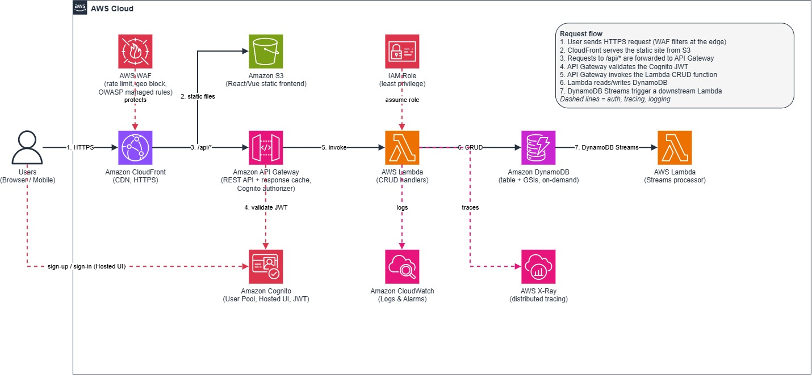

# Serverless REST API on AWS (Cognito, API Gateway, Lambda, DynamoDB, WAF)

A serverless records API built with Terraform. Users sign in with Amazon Cognito, call a REST API
(API Gateway + Lambda + DynamoDB), and everything sits behind CloudFront with WAF protection.

## Architecture



## How it works

1. The user sends an HTTPS request. WAF filters it at the edge (rate limit, OWASP managed rules, optional geo block).
2. CloudFront serves the static page from a private S3 bucket and forwards `/api/*` to API Gateway.
3. API Gateway validates the Cognito JWT, then invokes the CRUD Lambda.
4. Lambda reads and writes DynamoDB; each user only sees their own records.
5. DynamoDB Streams trigger a second Lambda for downstream processing.
6. X-Ray traces the calls, and CloudWatch collects logs and alarms (alerts go to SNS).

## AWS services

| Service | Purpose |
|---|---|
| CloudFront | CDN in front of S3 and the API |
| WAF | Rate limiting, OWASP/SQLi rules, geo blocking |
| S3 | Private bucket for the static frontend |
| API Gateway | REST API with a Cognito authorizer |
| Cognito | User Pool, Hosted UI, JWT tokens |
| Lambda | CRUD handler and DynamoDB Streams processor |
| DynamoDB | On-demand table with a GSI and Streams |
| IAM | Least-privilege roles for each Lambda |
| X-Ray, CloudWatch, SNS | Tracing, logs, alarms, notifications |

## API

All calls need the header `Authorization: <Cognito ID token>`.

| Method | Path | Action |
|---|---|---|
| POST | `/api/records` | Create a record |
| GET | `/api/records` | List my records |
| GET | `/api/records/{id}` | Get one record |
| PUT | `/api/records/{id}` | Update a record |
| DELETE | `/api/records/{id}` | Delete a record |

## Project structure

```
.
├── README.md
├── archi/        # architecture diagram  .jpg
└── terraform/    # all infrastructure code (Lambda code is embedded in lambda.tf)
```

## Deploy (optional)

Requires an AWS account, AWS CLI, and Terraform 1.5 or newer.

```bash
cd terraform
cp terraform.tfvars.example terraform.tfvars
terraform init
terraform apply
```

Check the code without an AWS account:

```bash
terraform init -backend=false
terraform validate
```

Clean up when finished: `terraform destroy`

## Cost note

Most services stay within the AWS Free Tier. AWS WAF and the optional API Gateway cache
(`enable_api_cache`, off by default) are not free, so run `terraform destroy` after testing.
